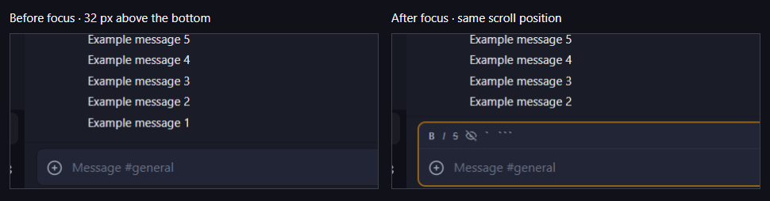

# Web, mobile and desktop UX backlog

Reviewed and implemented on 22 November 2026. The audit below records the original behavior, priorities and acceptance scenarios. The table tracks the delivered interactions and the evidence from the local release candidate.

## Voice rooms and first-load author colors

| Item | What changed | How to verify |
| --- | --- | --- |
| UX-29 · Stable author colors on first visit | Channel and thread history include the highest-priority colored role for each visible author and reply author. The server looks up the distinct authors on the page in one query. A completed roster takes over for live role changes and removals. | Hold the first roster response while opening a server. Check both author names before and after release. The PostgreSQL fixture also assigns the same user a higher role in another server. [Browser test](../tests/e2e/author-colors.spec.ts) · [Database test](../apps/server/src/messages/history-wire.integration.spec.ts) |
| UX-30 · Reply in text during a call | The voice room links to the last available text channel visited in its server. The desktop call panel and phone navigation return directly to the connected room and update its URL. Narrow room headers put controls on a second row. | Send a message, return to voice, and check the route, connection and microphone publication. The browser test also checks the text shortcut at 360, 768, 1024 and 1280 px. [Voice journeys](../tests/e2e/voice-calls.spec.ts) |
| UX-31 · Reach audio settings during a call | Audio settings are labeled in the room and available from the desktop call panel while chatting. On the phone, Back from call-specific settings returns to the originating view. Settings enumerate devices before requesting capture. | Open settings while connected. With device labels already available, Chrome's microphone capture count across join and settings went from two to one. Permission and cleanup tests exercise the fallback for missing labels. [Device tests](../apps/web/src/components/voice/hooks/useMediaDeviceSettings.test.ts) |
| UX-32 · Keep the selected tile while replying | The live call remembers the selected participant, share or grid across channel switches. A dismissed share stays in the grid. A newly published share can still take focus when the grid is active. | Focus a participant, reply in text, and return. Also exercise share replacement, a participant leaving, and starting another call. [Focus tests](../apps/web/src/components/voice/voiceTileFocus.test.ts) · [Voice journeys](../tests/e2e/voice-calls.spec.ts) |

The browser checks use local Chrome with simulated media devices. Physical iPhone Safari, hardware audio routing and the packaged desktop client remain device checks.

## Second pass · cache, gestures and shared UI

This pass started from commit `69a2b8f`. The before/after probes used the same local Chrome fixtures, real React components and browser IndexedDB. The phone fixture was 390 × 844. The counts below measure work directly. Frame timing and battery use require separate device measurements.

| Item | Delivered change | Before → after and regression coverage |
| --- | --- | --- |
| UX-19 · Keep the freshest conversation | Disk hydration rechecks the in-memory page and server list after its await. | Start a disk read, deliver a newer message page, then let the disk read finish. The visible cache winner changed from the disk copy to the network copy. An authoritative empty server list also survives an old read. [Tests](../apps/web/src/lib/cache/hydrate.test.ts) |
| UX-20 · Make cache cleanup cheaper | IndexedDB upgrades existing stores in place with timestamp indexes. Expiry, capacity and quota cleanup use keys to delete the oldest records. | Reopening a populated, same-account cache previously fetched the full contents of two stores for the expiry check. It now fetches expired keys and issues zero full-value reads. A populated v1 upgrade test preserves recent messages and server structure while expiring old records. [Tests](../apps/web/src/lib/cache/db.test.ts) |
| UX-21 · Give a touch sequence one action | The Chats drawer and message rows share the rule for yielding to vertical scrolling. Cancellation or a second finger disarms pending holds. Swiping interactive message text leaves its own control in charge. | A stroke starting at (180,150), moving down to (180,260) and ending at (70,165) formerly closed the drawer. It now stays open. Cancelling a reaction hold before 500 ms formerly opened the reactors list once. It now opens zero times. Clean horizontal dismissals, swipe reply and single-finger holds still work. [Drawer](../apps/web/src/components/layout/MobileDrawer.test.tsx) · [Reactions](../apps/web/src/components/chat/ReactionPill.test.tsx) |
| UX-22 · Show results for what is in the search field | Editing clears the preceding results, count and retry target during the debounce. Enter submits immediately. | Replacing a completed search previously left its result clickable under the new text. The prior hit now disappears on input, and the replacement query can be submitted or allowed to settle. [Search regressions](../apps/web/src/components/search/SearchDrawer.test.tsx) |
| UX-23 · Find the Inbox reading position cheaply | Inbox catch-up and conversation return share a hit test at the reading line and a binary lookup for covered or empty space. | At row 520 of 600, one Inbox scroll sample went from 521 row bounding-rectangle calls to zero on the unobstructed path. The binary lookup took 10 in that fixture. The log still measures its viewport. Tests cover partially visible rows, covered content and thread ownership. [Lookup tests](../apps/web/src/lib/visibleMessageRow.test.ts) · [Inbox tests](../apps/web/src/hooks/useInboxAnchor.test.ts) |
| UX-24 · Share responsive breakpoints | Components using the same phone or tablet query share one native media-query listener. The last consumer releases it. | For 60 phone-layout consumers, initial listener registrations fell from 60 to one. One rerender previously added and removed 60 listeners and now does neither. Changing the breakpoint still updates both subscribers in the lifecycle test. [Tests](../apps/web/src/hooks/useMobile.test.tsx) |
| UX-25 · Keep the quick switcher idle when closed | The command list mounts on open. Keyboard selection follows the command ID and falls back to the first available entry if the selected command disappears. | Before the fix, a closed mount built commands, and removing the selected option left Enter with no valid selection. Regression tests verified both failures first and now check reopening, selection, execution and focus return. [Tests](../apps/web/src/components/CommandPalette.test.tsx) |

The updated web suite passed 1,754 tests across 222 suites. All five signed-in Chrome journeys passed twice with retries disabled. A separate production check disconnected the browser and reloaded the same channel from its service worker and IndexedDB. The web production build and source lint passed. Physical touch and packaged Windows behavior remain device checks.

### Completed architecture findings and message delivery follow-up

| Item | Delivered behavior | Verification |
| --- | --- | --- |
| UX-26 · Offline history retention | The 30-conversation memory limit and 100-conversation disk limit operate independently. Full edits and deletes update disk-only pages in arrival order. Closing a DM or observing revoked access invalidates its history. A compact edit or delete hint with no row data drops that page until the next online fetch. Permission changes for a background server invalidate its cached history until access can be checked. | Tests open 31 and 101 conversations. Signed-in Chrome reopened edited history offline, excluded the deleted row and could not reopen a closed DM or a denied channel. A production service worker served a readable conversation after disconnect and reload. [Retention tests](../apps/web/src/lib/cache/messageDiskMirror.test.ts) · [Browser test](../tests/e2e/offline-retention.spec.ts) |
| UX-27 · Session-scoped cache work | Cache reads and writes check the account binding in their IndexedDB transaction. Hydration and idle flushes discard work after a local session change. Offline route restoration starts after cache binding begins. | Delayed hydration and flush tests cover rapid reauthentication. Two Chrome tabs shared same-account data, switched accounts and verified an old tab could neither overwrite nor purge the new account’s data, including after switching back. [Two-tab test](../tests/e2e/cache-ownership.spec.ts) |
| UX-28 · Phone settings navigation | Account and server settings share an index/detail layout. Returning restores the selected row, index scroll and filter. Opening a detail directly also gives Back a visible focus destination. | At 360 px and 145% root font size, Chrome preserved the entry and scroll position through the visible Back button, Escape and browser Back in English and Slovak. [Settings journeys](../tests/e2e/settings-navigation.spec.ts) |
| Duplicate incoming messages | Channel and DM history reconcile socket deliveries and overlapping pages by message ID. The gateway also excludes full-message watchers from its fallback broadcast during room enrollment. | A phone-sized Chrome session received two intentional identical messages over a live socket while HTTP catch-up was held. After release each ID had one row. Gateway tests cover a watcher receiving a message before its background-room membership is ready. [Phone test](../tests/e2e/message-delivery-race.spec.ts) · [Gateway test](../apps/server/src/gateway/message-subscriptions.spec.ts) |

Local verification passed 1,763 web tests and 1,344 server tests. The server runner skipped 91 tests. The web production build, source lint and 11 Chrome journeys passed. The phone checks used a browser viewport. Physical iPhone Safari and the packaged desktop client remain device checks.

## First pass · implementation and verification

| Item | Delivered behavior | Verification |
| --- | --- | --- |
| UX-01 | Aa opens formatting on demand. Typing or focusing the draft leaves the history boundary in place. Escape returns to the draft. | Signed-in Chrome kept both the bottom edge of the log and the message content at the same coordinates at gaps of 0, 29, 32 and 100 px. A selected word received spoiler markup. |
| UX-02 | The phone composer reserves Send, caps multiline growth against the visible viewport, and shows files in a single horizontally scrollable tray. | At 390 × 844 with a simulated 450 px keyboard viewport, staged 1, 6 and 20 files, then removed a middle file. With a reply and a multiline draft, Send stayed above the keyboard and the log retained more than 44 px. |
| UX-03 | Search and all selected tags constrain the server query before pagination. Empty, filtered and failed requests show distinct actions. | Chrome exercised nine tags, a search miss and a failed request followed by Retry. The PostgreSQL rollback test covered 202 posts, tag intersections, literal search and cursor scope. |
| UX-04 | Ordinary channel and DM returns use a bounded session reading position. Explicit links retain their target. | A desktop A → B → A round trip restored the same message ID and vertical offset. Unit coverage includes explicit jumps, zero-offset restoration and session reset. |
| UX-05 | A phone reader can return to a search with its scope, page, query, filter controls, scroll and result focus. | Chrome reopened the original result and verified focus. A component test reopened a saved page against its original channel after the current channel changed. |
| UX-06 | Sidebar and drawer pin commands await successful channel navigation. The pins hook consumes a request for its own channel once. | The signed-in browser test delayed navigation to B and saw one pin request for B. The hook regression checked that mounting A never consumed B’s request. |
| UX-07 | A drawer dismissal requires a dominant horizontal swipe toward its edge. Horizontally scrollable controls retain their gestures. | Chrome kept the drawer open for a diagonal stroke and dismissed it for a horizontal one. Unit cases cover directions, thresholds and scrollable children. |
| UX-08 | GIF results and their pagination cursor follow the active query. A failed next page retains tiles and offers Retry. | Chrome resolved cats after otters and kept otters visible. A unit test retried the failed page using the otters cursor. |
| UX-09 | Resizing previews width during the drag and saves once on release. | A 70 px drag in 30 steps wrote the settings key zero times during movement and once at release. Unit tests cover keyboard controls, cancellation and cleanup. |
| UX-10 | Rows within a timeline share one intersection observer. Initial rendering uses the number of displayed groups. | A 600-window regression verified one observer, 600 registrations and complete cleanup. Existing tests exercise parked targets, active selection, editors and keyboard focus. |
| UX-11 | Jump to unread and Mark as read are sibling buttons. | Component tests exercised each callback independently and checked the DOM relationship. |
| UX-12 | The quick switcher ranks prior accessible conversations first and shows channel server names. | Chrome returned from B to A with Ctrl+K and Enter. Unit coverage checks visit order, deduplication and clearing the account session. |
| UX-13 | A phone reader can swipe left to reply. The existing long-press action sheet remains available. | Chrome ignored a short stroke and opened a reply to the selected message on a completed stroke. |
| UX-14 | The log is keyboard reachable. Arrows focus visible or parked rows, R replies and Escape returns to the composer. | Chrome entered through the log, focused a row and replied. The parked-row tests preserve focus during observation. |
| UX-15 | Mobile server settings have a grouped, searchable index with a detail view. Back restores the filter, index position and focus. | At 360 px, Chrome found Audit Log and returned focus to the filtered row. The full settings journeys exercised Overview, Members, Bans, Onboarding, Emojis and Audit Log. |
| UX-16 | Screen-share setup retains its options after cancellation or device failure. Persistent call errors can be dismissed. | Chrome joined local LiveKit, cancelled capture, retried with a generated video track and remained connected. A separate call recovered from microphone denial. Unit cases check retained resolution and frame rate. |
| UX-17 | Native launch switches have names, confirmed states, independent pending/error feedback and retry. Windows commands propagate OS errors. | React tests delayed and rejected native operations. Rust tests distinguished missing, corrupt and unreadable preferences. |
| UX-18 | Server-settings translations, the Inbox panel and screen-share setup load when needed. An Inbox reading session still restores at sign-in. Offline channel navigation uses the signed-in account’s cached channel permissions and messages. | Production timing, offline checks and device limits are recorded below. |

The signed-in [interaction tests](../tests/e2e/ux-backlog.spec.ts), [voice tests](../tests/e2e/voice-calls.spec.ts) and [production startup checks](../tests/e2e/ux-startup.spec.ts) use local test accounts. Destructive settings and content actions run on disposable servers.

## Production startup and device coverage

The comparison used production builds of baseline `9729b48` and the candidate, signed into the same disposable channel with one message. Chrome ran at 1280 × 800 with 2× CPU throttling, 35 ms network latency and 2 MB/s download throughput. Each build and locale had three cold contexts and three warm reloads, for 24 navigations with alternating build order. The timer ended two animation frames after the message text appeared in the visible log. Service workers were disabled for this comparison and enabled in the separate offline check.

| Locale and cache | Median time to message, before → after | p95 time, before → after | Completed asset requests, before → after | Asset transfer bytes, before → after |
| --- | --- | --- | --- | --- |
| English, cold | 1,628 → 1,551 ms | 1,639 → 1,551 ms | 82 → 78 | 783,816 → 632,160 |
| English, warm | 1,319 → 1,237 ms | 1,325 → 1,239 ms | 82 → 78 | 24,600 → 23,400 |
| Slovak, cold | 1,746 → 1,615 ms | 1,793 → 1,627 ms | 97 → 92 | 833,117 → 676,414 |
| Slovak, warm | 1,502 → 1,324 ms | 1,514 → 1,331 ms | 97 → 92 | 29,100 → 27,600 |

The deferred Inbox panel took longer to open for the first time. The warm median from click to visible tabs went from **51 to 130 ms in English** and **55 to 130 ms in Slovak**. Asset counts include cached resource entries completed by the message timestamp. With three samples per condition, the nearest-rank p95 is the slowest observed run. These figures describe this local fixture.

For the offline check, Chrome loaded a signed-in channel, installed the production service worker, waited for its message, channel and permission records to reach IndexedDB, disconnected the browser and reloaded the direct channel URL. The original message appeared in the log. To repeat the checks, start the local web/API services, serve both production builds with the project’s Vite preview configuration on loopback ports 5191 (baseline) and 5192 (candidate), set `UX_STARTUP_PROFILE=1` and run `npx playwright test ux-startup`.

Phone geometry and gestures were exercised in Chrome with a simulated keyboard viewport. Physical iPhone and Android keyboards, assistive-technology announcements, native capture dialogs and packaged Windows startup behavior still need device checks. Drag write counts and observer counts are verified. Scroll and drag frame-time distributions on real hardware remain unmeasured.

## Original priorities

| Order | Work | Expected benefit |
| --- | --- | --- |
| P1 · first | UX-01 composer focus, UX-02 mobile attachments, UX-03 forum discovery, UX-04 reading position | Keep messages and Send visible, find existing discussions and resume reading after a switch. |
| P2 · next | UX-05 search return, UX-06 pins, UX-07 drawer gestures, UX-08 GIF results, UX-09 panel resizing, UX-10 history rendering, UX-11 unread actions | Remove repeat work, ambiguous actions and unnecessary rendering from common journeys. |
| P3 · evaluate | UX-12 quick switcher, UX-13 mobile replies, UX-14 keyboard reading, UX-15 settings discovery, UX-16 call recovery, UX-17 desktop preferences, UX-18 cold start | Shorten frequent tasks. Profile or usability-test each proposal before investing broadly. |

## What the browser showed

The walkthrough used the current local Vite app in headless Chrome with synthetic API responses, a 50-message channel, another text channel and a paginated forum. It exercised the 1280 × 800 desktop and 390 × 844 touch layouts, channel switching, settings, forum discovery and composer focus. Separate component fixtures exercised a simulated 450 px keyboard viewport and longer histories. Distances below are CSS pixels. The API, real-time delivery, operating-system keyboard and packaged Tauri window were outside these measurements. Entries marked **source** describe implementation paths or hypotheses for validation.

| Interaction | Observation |
| --- | --- |
| Focus at the bottom of a desktop channel | The formatting row grew the composer from 46 to 79 px. The history shrank from 681 to 648 px. The last row moved up 33 px and stayed visible. |
| Focus after scrolling up 32 px | Before focus the last row ended at y=725 inside a log ending at y=729. After focus the row still ended at y=725 and the log ended at y=696. **29 px of that row were clipped.** |
| Focus on a phone | The composer stayed 46 px high. Hiding the bottom navigation released 57 px before any keyboard resize. In the component fixture, typing the first character made room for Send and narrowed the textarea by 44 px. |
| Stage six small text files on a phone | With a 450 px simulated visible viewport, the message log shrank from 339 to 16 px. The input bar began at y=477, below the visible bottom. The fixture accepted the files and displayed the configured 25 MB limit. |
| Search a 26-post forum | Searching for the title of post 26 on both layouts displayed “No posts yet” and “Be the first to create a post!” alongside “Load more”. Loading the second page exposed the match. |
| Drag the desktop member-panel divider | A 70 px drag delivered in 30 pointer moves produced 30 writes to the persisted settings key. |
| Increase loaded history tenfold | At the same phone viewport, 60 and 600 ordinary text messages both mounted 51 message bodies. Active intersection observers grew from 60 to 600, and elements inside the log from 493 to 2,113. These counts describe work retained by the page. Frame cost needs a production trace. |

## First implementation candidates

### UX-01 · Keep the last visible message in place when composing

**Browser · web and shared desktop UI.** Open a populated channel, scroll to the end, move up 32 px and click the textarea. The six formatting buttons enter the normal layout on focus and disappear on textarea blur. The scroll hook already pins a reader at the bottom on viewport height changes, with a 30 px threshold. Just outside that threshold it preserves the scroll offset as the viewport shrinks. This explains both the clipping and why testing only at the bottom misses it. In the component fixture, Shift+Tab also hid the formatting controls before the reader could traverse them. [Composer](../apps/web/src/components/chat/ChatInputBar.tsx) · [Scroll handling](../apps/web/src/components/chat/hooks/useMessageScroll.ts)

**Proposal.** Give formatting a stable affordance inside the composer, such as an “Aa” button. Put the six actions behind that control and keep the toolbar open while focus moves within it. Ordinary focus, blur and the first typed character should leave the history boundary stable. Keep Ctrl/Cmd+B and I, the text selection, and the existing mobile keyboard handling. Increasing the bottom threshold alone would pull people out of history.

**Accept when** focusing and blurring with bottom gaps of 0, 29, 32 and 100 px leaves the same visible text at the same position within 1 px. Tab to formatting, apply a spoiler to selected text, dismiss it and keep typing. Repeat while replying, picking an emoji and using a narrow thread or forum panel. Confirm a newly arrived message still follows at the bottom and preserves the position of a reader farther up. [Thread composer](../apps/web/src/components/chat/ThreadPanel.tsx) · [Forum composer](../apps/web/src/components/forum/ForumPostPanel.tsx)

### UX-02 · Keep Send and the conversation reachable with attachments

**Browser fixture · mobile/PWA first.** Unsent files wrap into 128 px cards above the textarea. Six files occupied three rows on a 390 px phone. The outbox has a height cap, but the staged-file grid shares the available column with the input and history. The textarea itself can grow to 240 px. This can push Send outside the keyboard viewport while the user is still choosing what to send. [Staged files](../apps/web/src/components/chat/UnifiedInput.tsx) · [Textarea sizing](../apps/web/src/hooks/useAutosizeTextarea.ts) · [Outbox](../apps/web/src/components/chat/OutboxMessages.tsx)

**Proposal.** Keep a one-row attachment tray with an attachment count and a way to review all files. Keep individual removal, filenames, limit errors and restored drafts accessible. Bound multiline growth by the remaining visible height. Prototype reserving a stable Send slot on narrow screens so the first character also stays on its original line.

**Accept when** at 390 × 844 with a 450 px visible viewport, one, six and twenty attachments, a reply preview and a multiline draft still leave the input and Send fully visible and at least one ordinary message readable. Remove the middle file, restore the draft and retry a failed upload. Confirm with an actual iPhone PWA and Android keyboard, including keyboard dismissal and rotation.

### UX-03 · Make forum search and tag filters describe the whole forum

**Browser and source · all layouts.** “Search posts” filters only the pages in memory. The store requests 25 posts per page. Two selected tags also drop the server tag parameter, and the view's local filter checks only text. With more than eight tags the “All” control toggles state that the component never renders. A failed initial fetch can also fall through to the empty-forum invitation. These states invite people to create a duplicate post. [Forum view](../apps/web/src/components/forum/ForumView.tsx) · [Forum queries](../apps/web/src/stores/forum.store.ts)

**Proposal.** Apply search and tag selection before pagination and give multiple tags an explicit matching rule. Return separate states for an empty forum, an empty result, and a request that can be retried. Make “All” open the full tag selector. Preserve the query when opening and returning from a post.

**Accept when** the only matching post on page two appears from the first search. With two selected tags, every returned post follows the displayed rule across pages. Test nine or more tags, clear-all, a failed request and two quick successive searches. An empty search result gives a way to broaden it.

### UX-04 · Resume reading after a quick channel switch

**Browser · web and mobile.** In a read channel with 50 messages, move 360 px up, visit a second channel and return to the first. The desktop quick switcher and phone Chats drawer both returned to a bottom gap of 0. On each, a different message was now the first visible row. The navigation store remembers the last destination and can reuse a cached message window, but a normal sidebar request opens at unread and the scroll hook can snap to latest. A cached conversation still costs the reader their place. [Navigation history](../apps/web/src/stores/navHistory.store.ts) · [Sidebar intents](../apps/web/src/hooks/useAppNavigate.ts) · [Window preparation](../apps/web/src/stores/navigation.store.ts)

**Proposal.** Remember the first visible message ID and its offset when someone leaves a conversation mid-read. Use that anchor on an ordinary same-session return. Preserve explicit targets from search, notifications, Inbox and Jump to latest. If messages arrive while the reader is away, show the existing unread affordance without moving their place. Start with a bounded, account-scoped in-memory record.

**Accept when** A → B → A restores the same row and pixel offset on desktop and phone, including a cached return with new messages. A reader who left at the bottom should still follow latest. Verify a deleted anchor, a changed panel width, account switching and an explicit deep link into A. Keep restoration within the shared navigation coordinator.

## Navigation, interaction and performance

### UX-05 · Return from a message to the same search results

**Source · mobile priority.** Opening a result correctly waits for successful navigation before dismissing the mobile search. Dismissal clears the query in the channel and DM parents, and unmounting discards the drawer’s scope, page and selected result. Looking through several matches means reconstructing the search. Desktop already keeps the result list beside the conversation when space permits. [Result selection](../apps/web/src/components/search/SearchDrawer.tsx) · [Panel ownership](../apps/web/src/components/chat/MessageArea.tsx) · [Query state](../apps/web/src/components/search/useMessageSearch.ts)

**Proposal and check.** Give a reader a “Back to results” action that restores query, scope, filters, result page, scroll offset and focus. Starting a fresh search should still be easy. Open the third hit on page two in a channel and a DM, inspect a thread result, then return and open the fourth hit without retyping or resurfacing the keyboard. A deleted result should keep the list and its retry path.

### UX-06 · Open the requested channel’s pins after navigation succeeds

**Source · desktop sidebar and phone drawer.** Both context-menu paths start channel navigation and broadcast an untargeted “open-pinned” event 100 ms later. The receiver opens pins for whichever context is active at that moment. The pin fetch itself already protects against stale responses. The timing risk is in getting to the panel. [Desktop entry](../apps/web/src/components/channel/ChannelSidebar.tsx) · [Mobile entry](../apps/web/src/components/layout/MobileNavDrawer.tsx) · [Pins receiver](../apps/web/src/components/chat/hooks/usePinnedMessages.ts)

**Proposal and check.** Carry the target channel through the existing navigation outcome and open its panel after that destination owns the surface. From A request B’s pins with B’s load delayed, then try again while switching to C. B’s pins should open once on success, a cancelled request should leave C alone, and a denied channel should show the existing recovery UI. [Navigation contract](./MESSAGE_NAVIGATION_AUDIT.md)

### UX-07 · Keep the mobile drawer open during diagonal scrolling

**Browser event check and source · mobile.** The drawer dismisses after 60 px of horizontal travel in the closing direction. It records only the X coordinate. A synthetic stroke 67 px left and 230 px up dismissed the Chats drawer. A long channel list or a horizontal child control can therefore lose its place during a mainly vertical movement. [Drawer touch handling](../apps/web/src/components/layout/MobileDrawer.tsx)

**Proposal and check.** Require a predominantly horizontal gesture before taking ownership and respect scrollable child controls and cancelled touches. Preserve the existing explicit close, backdrop, Back and focus restoration. Verify a vertical flick, the measured diagonal, a clean horizontal dismissal and a reversed gesture on both drawer sides. Repeat with real touch input and reduced motion.

### UX-08 · Keep GIF results tied to the current query

**Browser and source · composer media picker.** In the phone shell, a slow “cats” request finished after the newer “otters” results were visible. The field still read “otters” while its tile changed back to “cats”. Debouncing limits new requests, but earlier trending, search and pagination responses can still update the list and loading state. A failed next page shows no retry when there are already tiles. A reader can pick a GIF from the previous search. Message search already has request ownership and cancellation to reuse. [GIF picker](../apps/web/src/components/GifPicker.tsx) · [Message search](../apps/web/src/components/search/useMessageSearch.ts)

**Proposal and check.** Associate results, cursor, error and loading with one query generation. Keep existing tiles on a failed next page and offer retry there. Delay “cats”, type “otters”, finish “otters” first, then finish “cats”. The tiles and next-page cursor should still belong to “otters”. Repeat with slow trending results and after closing the picker.

### UX-09 · Save panel widths once per drag

**Browser · desktop web and shared Tauri UI.** The member divider wrote settings on every measured pointer move. The handle sends the width directly into a store persisted to local storage. Width changes also reflow message text and activate the timeline’s width-restoration path. This is a specific source of avoidable synchronous work while following the pointer. [Resize handle](../apps/web/src/components/layout/PanelResizeHandle.tsx) · [Member panel](../apps/web/src/components/chat/MessageArea.tsx) · [Persisted settings](../apps/web/src/stores/settings.store.ts)

**Proposal and check.** Preview the width locally, coalesce preview updates per animation frame, and persist the final value once. Repeat the 70 px, 30-step drag with images and wrapped text visible. Count writes, compare frame times and track the same message on screen. Check keyboard arrows, Home/End, double-click reset, pointer cancellation and reopening the app. Apply the result to the shared secondary-panel divider.

### UX-10 · Keep long histories cheap while preserving jumps and active rows

**Browser counts and source · all layouts.** Parking offscreen message bodies works. The fixture retained 51 bodies at both history sizes, but every group kept a wrapper and its own intersection observer. Initial mounting also compares a group index with the raw message count. In a heavily grouped window, the last groups can start parked until observation catches up. [Row lifecycle](../apps/web/src/components/chat/WindowedMessage.tsx) · [Message rendering](../apps/web/src/components/chat/MessageSurface.tsx) · [Grouping rules](../apps/web/src/lib/messageGrouping.ts)

**Proposal and check.** First profile a shared observer per scroll root and correct the initial end range to use rendered groups. Run the same scroll, prepend and jump at 60 and 600 messages with plain text, media and grouped duplicates. Record live observer count, mounted rows, frame-time distribution and jump error in pixels. Keep alias IDs, keyboard focus, text selection, playing media, unread boundaries and the active editor intact. Adopt deeper virtualization only if the measured frame or memory cost warrants it.

### UX-11 · Give unread navigation and acknowledgement separate targets

**Source · channel and DM histories.** The unread pill is a jump button containing a separately focusable “Mark as read” span with button semantics. Event propagation is handled manually. Two important actions share a hit area and form nested controls for assistive technology. Inbox catch-up already distinguishes reading, skipping and marking done. [Unread pill](../apps/web/src/components/chat/MessageSurface.tsx) · [Inbox reader](../apps/web/src/components/notifications/InboxReadingBar.tsx)

**Proposal and check.** Keep the compact pill appearance and use sibling buttons with distinct names, focus indicators and touch targets. Verify Tab, Enter, Space, touch, and a screen reader on a narrow channel. Jump should position the divider. Explicit acknowledgement should run once and preserve the reader’s position. Check existing visibility-based read behavior independently.

## Proposals to validate

| ID and surface | Current interaction and proposed benefit | Acceptance check |
| --- | --- | --- |
| **UX-12 · Quick switcher** · all layouts | The existing Ctrl/Cmd+K palette navigates correctly. An empty query lists available commands in registration order, with channels drawn from the loaded channel store. Put recent, accessible conversations first and show server context for ambiguous names. This makes returning to a conversation a two-key action. [Commands](../apps/web/src/lib/commands/useBuiltInCommands.tsx) · [Filter](../apps/web/src/lib/commands/registry.ts) · [Discord quick switcher](https://support.discord.com/hc/en-us/articles/115000070311-Quick-Switcher) | From B, open the switcher and press Enter to return to A. Check two channels called “general”, a closed DM, revoked access, account switching, and the same recent items from the mobile drawer. |
| **UX-13 · Quick reply** · phones | A message long-press opens the action sheet after 500 ms, and any touch move cancels the timer. Prototype swipe-to-reply with a direction lock, visible reply cue and release threshold. Keep Reply in the sheet as the discoverable alternative. [Message row](../apps/web/src/components/chat/MessageRow.tsx) · [Action sheet](../apps/web/src/components/chat/MobileMessageDrawer.tsx) · [Discord mobile interactions](https://support.discord.com/hc/en-us/articles/12654190110999-New-Mobile-App-Updates-Layout) | Compare time and wrong-target replies with the long-press flow. A short swipe cancels, vertical scroll stays smooth, swiping a link or gallery has predictable behavior, and the keyboard opens on the intended draft. Evaluate alongside UX-07. |
| **UX-14 · Read and act using the keyboard** · web/desktop | Message rows handle Shift+F10 but have a negative tab index. Skip navigation and a shortcut guide already exist. Provide a predictable way into the timeline, arrow between rows, invoke the existing actions, and return to the composer. [Row keys](../apps/web/src/components/chat/MessageRow.tsx) · [Shortcut inventory](../apps/web/src/lib/keyboardShortcuts.ts) · [Discord keyboard navigation](https://support.discord.com/hc/en-us/articles/1500000056121-Keyboard-Navigation-FAQ) | Starting in the channel list, read an older row, open its menu, reply and return to the draft using only keys. Repeat over a parked row and inside a thread. Preserve text editing shortcuts, browser shortcuts and visible focus. |
| **UX-15 · Find settings by task** · phone first | User settings already has a grouped phone index. Server settings presents 15 categories in a single horizontally scrolling strip with a hidden scrollbar. Reuse the index/detail pattern for server administration and make labels searchable by task, such as “audit” or “welcome”. [User settings](../apps/web/src/components/settings/SettingsModal.tsx) · [Server settings](../apps/web/src/components/server/ServerSettingsModal.tsx) · [Categories](../apps/web/src/components/server/server-settings/serverSettingsTypes.ts) | At 360 px and enlarged text, find Audit Log and Onboarding without sideways hunting. Back restores the prior index position. Test translated labels and existing permission gates. |
| **UX-16 · Recover from a failed call action** · all layouts | The call controls clear a voice error after five seconds. Confirming screen share closes the dialog before starting capture. A failed attempt can send the caller through settings again. Keep actionable failures near the control, retain the chosen settings where safe, and distinguish cancellation from device failure. [Call controls](../apps/web/src/components/voice/useVoiceControls.ts) · [Call header](../apps/web/src/components/voice/VoiceRoom.tsx) | Cancel the system picker, deny capture, and unplug a selected device. A caller can understand the outcome and retry the recoverable case while still connected, with mute and disconnect reachable. Verify on a real call and packaged desktop. |
| **UX-17 · Make native startup preferences trustworthy** · packaged desktop | Startup toggles use visible text beside switch elements without passing accessible names. A failed read can leave default-looking values enabled. One failed write is silent and the other silently rolls back. Reuse the named toggle pattern and show pending, failure and retry at the affected setting. [Desktop preferences](../apps/web/src/components/settings/sections/DesktopAppSection.tsx) · [Named toggle row](../apps/web/src/components/settings/ToggleRow.tsx) | Test Start at login and Start minimized with keyboard and a screen reader. Delay and reject each native read/write. A switch should announce its name and confirmed state, accept a retry, and agree with the OS after reopening settings. |
| **UX-18 · Shorten the path to the first readable conversation** · PWA/web/desktop | The authenticated layout waits for all 15 translation namespaces, including events and server settings. The authenticated inbox also loads its module at sign-in to restore reader state even when its panel is closed. Measure the cold path and defer optional UI or namespaces where that measurably advances the first readable message. [App entry](../apps/web/src/App.tsx) · [Locale loading](../apps/web/src/i18n/loadBundles.ts) · [Inbox startup](../apps/web/src/components/notifications/InboxWorkspace.tsx) | Compare production cold and warm launch in English and Slovak with a throttled network/CPU. Record bytes, request count, time to readable history and first opening of the deferred feature. Verify offline PWA launch, direct links, catch-up resume and absence of raw translation keys. |

## How to judge smoothness

Use the geometry and count baselines above for regression checks. For timing comparisons use a production build, record the browser/device, zoom, viewport, dataset, network and CPU settings, and separate cold from cached runs. Repeat the same interactions and report median and p95 alongside sample count. Measure click to **correct visible message**, keypress to **painted text**, and drag/scroll **frame times**. An updated route or a completed fetch alone misses the delay the reader experiences. Share socket/request measurements with the existing [client refresh initiative](./BACKLOG.md#scal-004-live-update-and-client-refresh-efficiency).

Run UX-01/02 first on desktop Chrome, iPhone Safari and installed PWA, Android Chrome and the packaged Windows client. Include a 768–1023 px tablet or narrow desktop, large text and reduced motion. Use physical keyboards and real IMEs for focus/rotation checks. For each item, record the starting message or search result, the action, what stayed visible and where focus landed. A change that improves one platform should still preserve the existing shared [message navigation guarantees](./MESSAGE_NAVIGATION_AUDIT.md).
